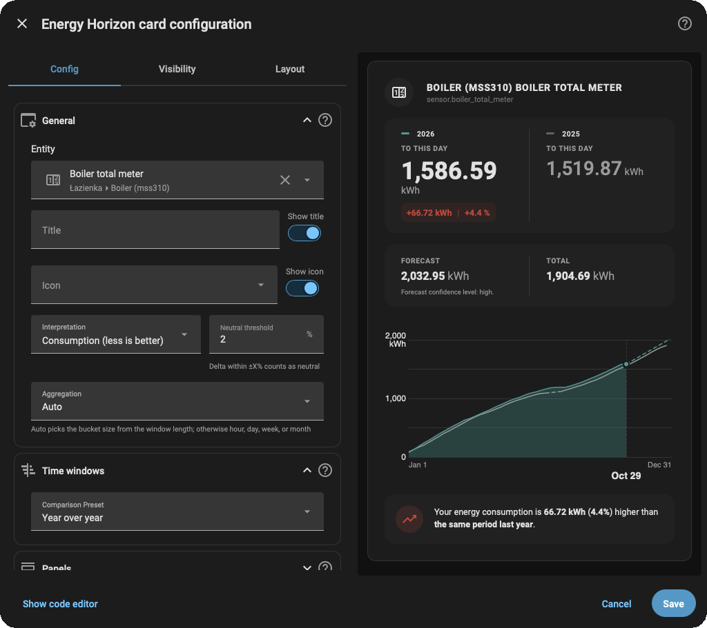

# Energy Horizon Card

Elegant energy comparisons for Home Assistant dashboards — **cumulative usage** now vs a historical reference, with optional forecast.

&ensp;
  
&ensp;
[](https://www.gnu.org/licenses/gpl-3.0)&ensp;


**Energy Horizon Card** is a high-performance Lovelace dashboard card for Home Assistant. It enables period-over-period visualization and analytical comparison of cumulative energy consumption and solar generation. 

By querying Home Assistant's **Long-Term Statistics (LTS)**, Energy Horizon overlays current progress against historical baselines (e.g., Year-over-Year, Month-over-Month) to immediately reveal whether your energy trajectory is ahead of or behind expected trends.

> This card is built for **long-term statistics** (energy history), not live power charts.


## Quick start (copy/paste)

### 1) Install

[](https://my.home-assistant.io/redirect/hacs_repository/?owner=hello-sebastian&repository=Energy-Horizon&category=frontend)

- **Marketplace (HA 2026.11+, recommended)**: Settings → **Marketplace** → search for **Energy Horizon** (or **Add from link** → `https://github.com/hello-sebastian/Energy-Horizon`) → **Install** → reload the browser. The dashboard resource is added automatically.
- **HACS (HA < 2026.11)**: HACS → **Frontend** → **Add repository** → install **Energy Horizon Card** → restart Home Assistant.
- **Manual**: download `energy-horizon-card.js` from the [latest release](https://github.com/hello-sebastian/energy-horizon/releases/latest) → copy to `config/www/`.

### 2) Add the Lovelace resource

**Marketplace (HA 2026.11+)**: the dashboard resource is added automatically — nothing to do. If you manage resources in YAML, use:

```yaml
url: /local/community/Energy-Horizon/energy-horizon-card.js
type: module
```

**HACS (HA < 2026.11)**: Settings → Dashboards → Resources:

```yaml
url: /hacsfiles/energy-horizon-card/energy-horizon-card.js
type: module
```

Manual installs usually use:

```yaml
url: /local/energy-horizon-card.js
type: module
```

### 3) Add the card

```yaml
type: custom:energy-horizon-card
entity: sensor.your_energy_statistic
comparison_preset: year_over_year
```

### 4) If you see an empty chart

Most often, the selected entity has **no long-term statistics**.

- Check Home Assistant **Developer Tools → Statistics**.
- Then follow: [Troubleshooting and FAQ](https://github.com/hello-sebastian/energy-horizon/wiki/Troubleshooting-and-FAQ).


## Why Energy Horizon?

Standard Home Assistant dashboards excel at displaying historical totals, but they make it difficult to answer critical questions:

* *Are we consuming more electricity this November compared to last November?*

* *Is our solar array yielding as much cumulative power this month as it did during the same timeframe last year?*

* *Based on our rate of consumption so far, where will we end up by the end of the billing period?*

Energy Horizon bridges this gap by rendering **aligned, cumulative comparison curves** combined with **predictive end-of-period forecasting**, operating 100% locally on your Home Assistant frontend.

## Key Features

### Period-over-Period Cumulative Comparison

Overlay current energy progress directly against equivalent historical baselines—such as Year-over-Year (YoY), Month-over-Month (MoM), or matching historical calendar months—to track long-term performance without manual data extraction.

### Context-Aware Semantics (Consumption vs Production)

Tailored visual feedback based on your data type. In **Consumption mode**, lower usage relative to the baseline is highlighted as a positive achievement. In **Production mode** (for solar/PV generation), higher yields trigger positive indicators.

### Smart Baseline Forecasting

Extrapolates your current rate of energy generation or usage to project your final total at the end of the active period. The forecast combines real-time progress with historical trends to provide a realistic target line.
- Learn more: [Forecast and Data Internals](https://github.com/hello-sebastian/energy-horizon/wiki/Forecast-and-Data-Internals) and [README.advanced](README.advanced.md)

### Adaptive Timeline Granularity

Dynamically selects the optimal temporal resolution (hourly, daily, weekly, or monthly slots) depending on your selected time window, ensuring smooth charts and high performance on mobile devices without cluttering the screen.
- Learn more: [Aggregation and Axis Labels](https://github.com/hello-sebastian/energy-horizon/wiki/Aggregation-and-Axis-Labels) and [How-To: Aggregation & Performance](https://github.com/hello-sebastian/energy-horizon/wiki/How-To-Aggregation-and-Performance)


### Zero-Backend Overhead

Queries Home Assistant’s native Long-Term Statistics (LTS) directly via WebSocket. Requires no custom backend integration, database modifications, or external cloud services.

### Prerequisites

To display energy data, Energy Horizon requires a Home Assistant entity that records **Long-Term Statistics (LTS)** with cumulative states.

* **Supported Units:** `kWh`, `Wh`, or `MWh` and what's more `m³` and `l` work too.

* **Required Entity Attributes:** Must have `state_class: total` or `state_class: total_increasing` (e.g., utility meters, energy grid import sensors, or total solar yield sensors).

*Note: Instantaneous power sensors measuring `kW` or `W` cannot be used directly for cumulative comparison without being processed by Home Assistant's Riemann Sum Integration first.*


## Basic configuration

### Visual editor



The Lovelace visual editor now covers the **full configuration surface** — every parameter above (and the advanced ones) is editable in the GUI, organized into seven sections: **General**, **Time windows**, **Panels**, **Formatting & Localization**, **Chart settings**, **Style**, and **Diagnostics** (with subsections such as **Custom settings**, **Unit**, **Dates**, **Current series**, and **Reference series**). **General** and **Time windows** are expanded by default; the rest are collapsed. You do not need to touch YAML to configure the card. In **General**, the **Show title** and **Show icon** toggles sit in the same row as the **Title** and **Icon** fields, respectively.

What each section configures:

- **General** — the entity, header title/icon, interpretation (consumption vs production), neutral threshold, and aggregation.
- **Time windows** — the comparison preset; when the preset is **custom**, a **Custom settings** subsection exposes the `time_window` block (`anchor`, `duration`, `step`, `count`, `offset`).
- **Panels** — which card panels are visible (comparison summary, forecast & reference total, narrative comment).
- **Formatting & Localization** — the card language, unit prefix, number format, precision, and the Luxon date formats for the axis and tooltip.
- **Chart settings** — the forecast line, null-gap bridging, and the legend.
- **Style** — the current/reference series colors and fills (two-column layout).
- **Diagnostics** — the `debug` flag for extra console output.

**Jump straight to the docs:** every section header carries a small help-circle icon that opens the wiki chapter covering that section's keys (in a new tab). **Helper texts:** non-obvious fields — the time window syntax, the Luxon date formats, aggregation, precision, and the neutral threshold — show a short helper text below the control; the full reference is in the wiki. **Visual → YAML:** every control maps 1:1 to a YAML key — the full control → key table, a worked example, and the round-trip behavior are in [`README.advanced.md`](./README.advanced.md#lovelace-editor).

<!-- IMAGE PLACEHOLDER: Screenshot of the visual editor showing all seven sections (General and Time windows expanded, the rest collapsed), with the MDI section icons and the help-circle (documentation) icon visible in each section header. -->

Advanced users can still switch to **YAML mode** inside the editor: both modes show the complete config, and switching between them is lossless in both directions. See [`README.advanced.md`](./README.advanced.md) for the full editor reference.


### Basic YAML configuration

These are the options most people adjust first. Everything else is in the [Wiki](https://github.com/hello-sebastian/energy-horizon/wiki) and [`README.advanced.md`](./README.advanced.md).

| Option | What it does | Learn more |
|---|---|---|
| `comparison_preset` | Pick the comparison: year-over-year / month-over-year / month-over-month. | [First Comparisons: Quick Recipes](https://github.com/hello-sebastian/energy-horizon/wiki/First-Comparisons-Quick-Recipes) |
| `aggregation` | Control the chart resolution (`hour`/`day`/`week`/`month`) or omit for auto. | [How-To: Aggregation & Performance](https://github.com/hello-sebastian/energy-horizon/wiki/How-To-Aggregation-and-Performance) |
| `show_forecast` | Show/hide the dashed forecast line. | [Forecast and Data Internals](https://github.com/hello-sebastian/energy-horizon/wiki/Forecast-and-Data-Internals) |
| `precision` | Decimal places for UI numbers. | [Configuration and Customization](https://github.com/hello-sebastian/energy-horizon/wiki/Configuration-and-Customization) |
| `force_prefix` | Unit scaling (`auto`, `none`, `k`, `M`, …). | [Configuration and Customization](https://github.com/hello-sebastian/energy-horizon/wiki/Configuration-and-Customization) |
| `primary_color` | Current series line/fill color; default is the card’s brand teal (`#119894`). Use `ha-primary` or `var(--primary-color)` to follow your HA theme. | [`README.advanced.md`](./README.advanced.md) |
| `show_comparison_summary`, `show_forecast_total_panel`, `show_narrative_comment` | Hide specific card sections (comparison panel, Forecast \| Total panel, narrative comment). | [Configuration and Customization](https://github.com/hello-sebastian/energy-horizon/wiki/Configuration-and-Customization) |
| `interpretation` | `consumption` (default) or `production` — controls whether “higher than reference” reads as **bad** (usage) or **good** (generation) for the **narrative row**, **trend icon**, and **chart delta** colors. Period wording in the narrative follows merged **`time_window.step`** (not calendar heuristics). Does **not** change delta chip `+/−` math or Forecast \| Total copy. | [`README.advanced.md`](./README.advanced.md) |
| `neutral_threshold` | Optional percent band **T** (default **2**): when the chip’s signed percent **p** satisfies **|p| ≤ T**, narrative + chart delta use **neutral** “similar” styling. Invalid values fall back to **2**. GUI-editable in v1.2.0 (General section). Previously `neutral_interpretation` (deprecated alias; backward compatibility will be removed in a future release). | [`README.advanced.md`](./README.advanced.md) |
| `title`, `icon` | Card header customization. | [Configuration and Customization](https://github.com/hello-sebastian/energy-horizon/wiki/Configuration-and-Customization) |

**Custom period anchor (optional YAML)** — e.g. a **12‑month “year” from 5 May** (not 1 Jan): merge `time_window` with a compound ISO `offset` such as `P4M4D` on `start_of_year`. Invalid `offset` strings fail with the **same** card error as other invalid `time_window` fields. See [`README.advanced.md`](./README.advanced.md) and [How-To: Time Windows](https://github.com/hello-sebastian/energy-horizon/wiki/How-To-Time-Windows).

```yaml
time_window:
  anchor: start_of_year
  offset: P4M4D
  duration: 1y
  step: 1y
  count: 2
```


## Advanced configuration

Want more control? Start here:

- **Custom time windows** (`time_window`):
  - How-to: [How-To: Time Windows](https://github.com/hello-sebastian/energy-horizon/wiki/How-To-Time-Windows)
  - Reference: [Time Window Reference](https://github.com/hello-sebastian/energy-horizon/wiki/Time-Window-Reference)
- **Date formatting (Luxon)** (`x_axis_format`, `tooltip_format`):
  - Reference: [Luxon Formats Reference](https://github.com/hello-sebastian/energy-horizon/wiki/Luxon-Formats-Reference)
- **Full YAML reference (authoritative)**:
  - [`README.advanced.md`](./README.advanced.md)
  - Wiki: [Configuration and Customization](https://github.com/hello-sebastian/energy-horizon/wiki/Configuration-and-Customization)

## Documentation map

- **Wiki Home (Diátaxis map)**: [Energy Horizon Wiki](https://github.com/hello-sebastian/energy-horizon/wiki)
- **Advanced reference**: [`README.advanced.md`](./README.advanced.md)

## Support and releases

- Releases: [GitHub Releases](https://github.com/hello-sebastian/energy-horizon/releases)
- Issues: [GitHub Issues](https://github.com/hello-sebastian/energy-horizon/issues)
- Discussions: [GitHub Discussions](https://github.com/hello-sebastian/energy-horizon/discussions)


## Development

Stack: **TypeScript** (strict), **Lit** 3, **Apache ECharts** 5, **Luxon** 3 (time windows), **Vite** 6, **Vitest** 2.

User-visible strings live in [`src/translations/`](./src/translations/) (`en.json` is the key reference). Use **one full sentence per message** with `{{camelCase}}` placeholders for injected values — see [`specs/002-i18n-localization/`](./specs/002-i18n-localization/).

```bash
npm install
npm run build
npm run dev
npm test
npm run typecheck
npm run lint
```

### Deploy to your own Home Assistant

The build produces a single file, `dist/energy-horizon-card.js`. Copy it to your HA instance's `config/www/` directory:

```bash
npm run build
scp dist/energy-horizon-card.js root@<your-ha-host>:/config/www/
```

The `npm run deploy` script in `package.json` is preconfigured for the author's instance (SSH alias `ha` in `~/.ssh/config`). To deploy to your own instance without editing the script, override the host and/or path:

```bash
DEPLOY_HOST=root@<your-ha-host> DEPLOY_PATH=/config/www/ npm run deploy
```

## License

Energy Horizon
Copyright (C) 2026 Sebastian Sikora
https://github.com/hello-sebastian/Energy-Horizon

This program is free software: you can redistribute it and/or modify it under the terms of the GNU General Public License as published by the Free Software Foundation, either version 3 of the License, or (at your option) any later version.
